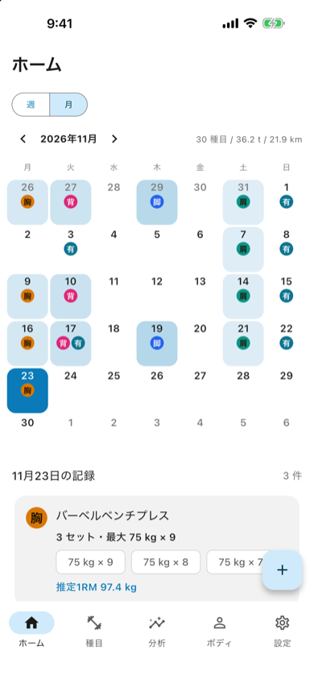
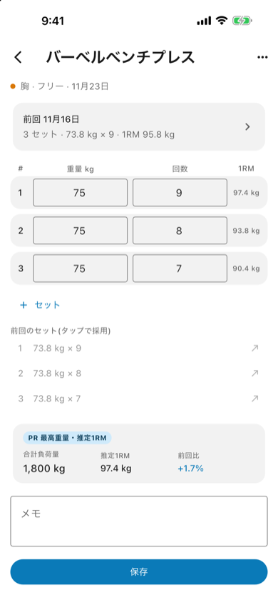
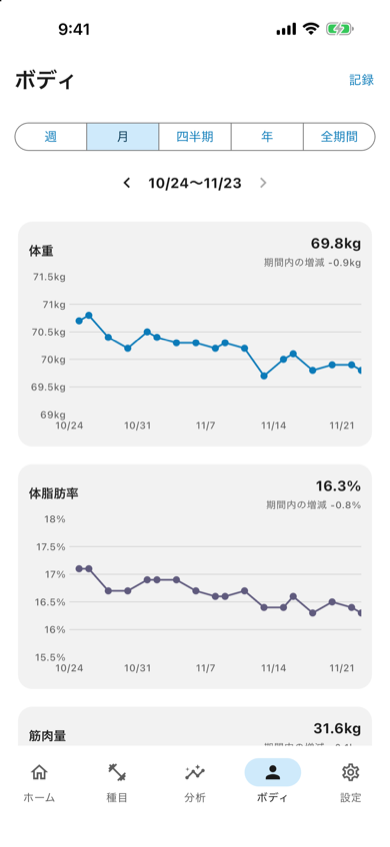
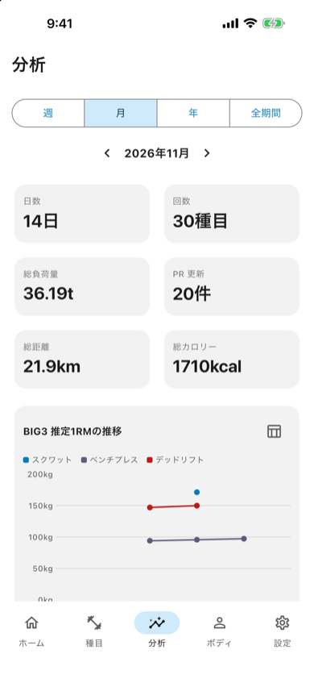
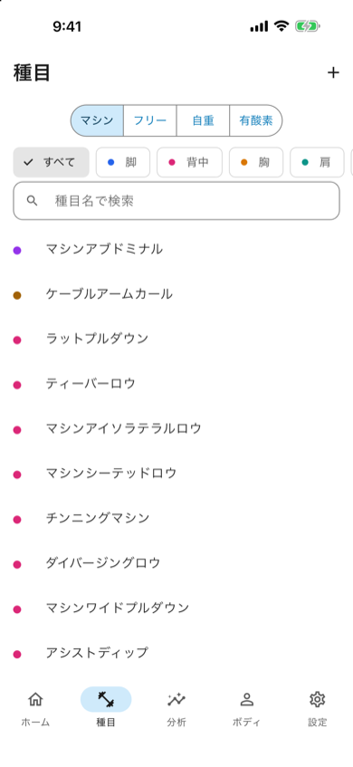
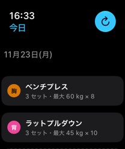
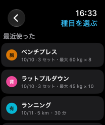
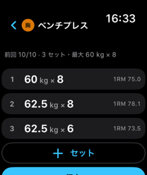
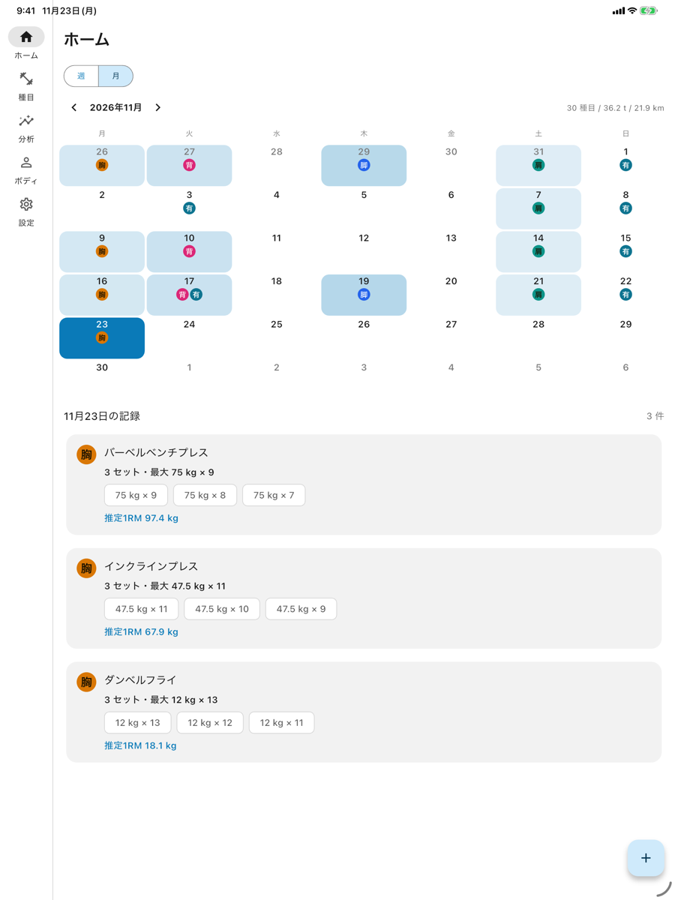

# biribiri

**筋トレ・フィットネス記録**

ジムでのトレーニングを、iPhone でも Apple Watch でもすばやく記録。 
部位ごとのカレンダー、推定 1RM、体重のグラフ、ヘルスケア連携、iCloud 同期に対応した、広告も会員登録もないトレーニング記録アプリです。

<!-- DOWNLOAD -->
**App Store で審査中です。公開されたら、ここにダウンロードのリンクを載せます。**
<!-- /DOWNLOAD -->

 

---

## どんなアプリ?

biribiri は、筋トレ(マシン・フリーウェイト・自重)と有酸素運動の記録、体重の管理をひとつにまとめたアプリです。

- **すばやく記録**: 種目を選んで、重量と回数を入れるだけ。前回のセットをタップで呼び出せます
- **ひと目で振り返り**: カレンダーに、その日に鍛えた部位のバッジが付きます
- **成長が見える**: 推定 1RM、自己ベスト(PR)、月ごとの総負荷量を自動で計算します
- **プライバシー**: 開発者のサーバーはありません。記録は、あなたの端末と、あなた自身の iCloud にだけ保存されます

## できること

### 記録する

<table>
<tr>
<td width="220"></td>
<td>

**部位ごとのカレンダー**

ホームのカレンダーで、どの日にどの部位を鍛えたかがひと目で分かります。月の合計(種目数・総負荷量・距離)も表示します。

- 週と月の表示を切り替えられます
- 予定を立てておき、終わったら「実施」に切り替えられます

</td>
</tr>
<tr>
<td></td>
<td>

**セットの入力**

重量・回数(有酸素なら時間・距離)をセットごとに入れます。

- 前回の記録が上に出て、前回のセットはタップで採用できます
- 推定 1RM、合計の負荷量、前回比をその場で計算します
- 自己ベストを更新すると **PR** のバッジが付きます
- マシン・フリーウェイト・自重・有酸素の 4 種類。種目と部位は自由に追加・編集できます

</td>
</tr>
</table>

### 振り返る

<table>
<tr>
<td width="220"></td>
<td>

**分析**

週・月・年・全期間で、トレーニングの日数・回数・総負荷量・PR の更新数・距離・カロリーを集計します。

- BIG3(ベンチプレス・スクワット・デッドリフト)の推定 1RM の推移
- 部位別の総負荷量のグラフ
- BIG3 の目標と現状の比較

</td>
</tr>
<tr>
<td></td>
<td>

**種目ごとの履歴**

種目の一覧から、部位ごとに最後にやった日、記録の回数、最高重量が分かります。種目を開くと、その種目の履歴とグラフが見られます。

</td>
</tr>
</table>

### 体を管理する

<table>
<tr>
<td width="220"></td>
<td>

**体重・体脂肪率・筋肉量**

週・月・四半期・年・全期間のグラフで、体の変化を追えます。

- 「ヘルスケア」App から体重・体脂肪率を取り込めます
- 摂取カロリーと消費カロリーの収支を、カレンダーで確認できます(ヘルスケアの摂取カロリーを使います)
- 有酸素の運動を、ヘルスケアにワークアウトとして書き込めます(任意)

</td>
</tr>
</table>

### Apple Watch

iPhone を出さずに、手首で記録できます。

- 今日の記録の確認
- 最近使った種目、または部位から種目を選んで追加
- Digital Crown で重量と回数を入力し、そのまま保存

Watch で保存した記録は、iPhone(または iPad)の biribiri に反映されます。

### iPad と同期

- iPad では大きな画面に合わせたレイアウトで表示します
- 同じ Apple ID の iPhone・iPad・Apple Watch の間で、iCloud を使って自動で同期します
- ファイルへのバックアップと読み込み、CSV の書き出しができます
- ライト / ダークテーマ、kg / lb を切り替えられます

## プライバシー

- 開発者のサーバーはありません。解析・広告の仕組みも入っていません
- 記録やヘルスケアの情報が、開発者や第三者に送られることはありません
- データは、あなたの端末と、あなた自身の iCloud(同期をオンにしたとき)にだけ置かれます

詳しくは [プライバシーポリシー](https://kazukinakaya.github.io/biribiri-support/privacy.html) をご覧ください。

## 動作環境

| | |
| --- | --- |
| iPhone | iOS 17 以降 |
| iPad | iPadOS 17 以降 |
| Apple Watch | watchOS 10 以降(iPhone の biribiri が必要) |
| 言語 | 日本語 |
| 価格 | 無料 |

## サポート

- [サポートページ](https://kazukinakaya.github.io/biribiri-support/)(よくある質問)
- 不具合の報告・ご要望: [Issue を作成する](https://github.com/KazukiNakaya/biribiri-support/issues/new)(GitHub のアカウントが必要です。Issue は公開されるので、個人的な記録や連絡先は書かないでください)
